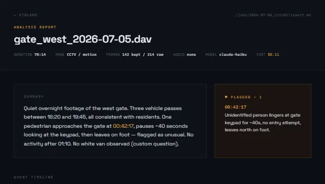

# VidLens

[](https://github.com/muhammadrakib2299/VidLens/actions/workflows/ci.yml)
[](LICENSE)

Local video-analysis pipeline. Point it at a video (local file or YouTube URL)
and it extracts key frames, de-duplicates them, transcribes audio, sends the
frames to Claude for vision analysis, and writes a searchable report.

This is the working backend for the VidLens design mockups
([`design/VidLens App.dc.html`](design/), [`design/VidLens Report.dc.html`](design/)).



## Pipeline

```
download → probe → frames → dedupe → transcribe → analyze → report
(yt-dlp)   (ffprobe) (OpenCV)  (phash)  (whisper)   (Claude)   (md + html)
```

Each stage caches its output under `jobs/<id>/`, so an interrupted run is safe
to resume — re-running the same job skips completed stages (use `--force` to
redo them).

## Install

```bash
pip install -r requirements.txt          # everything, run with: python -m vidlens ...
# or install as a CLI (adds the `vidlens` command):
pip install ".[all]"                      # core + Whisper + yt-dlp
pip install .                             # core only (no transcription / YouTube)
```

Plus **ffmpeg/ffprobe** on your PATH (not pip-installable):
Windows → `winget install Gyan.FFmpeg` or https://ffmpeg.org/download.html

Set your API key:

```bash
setx ANTHROPIC_API_KEY "sk-ant-..."     # Windows (new shells)
export ANTHROPIC_API_KEY="sk-ant-..."   # macOS/Linux
```

Check everything is in place:

```bash
python -m vidlens doctor
```

## Usage

```bash
# Estimate cost before running
python -m vidlens estimate --frames 142 --model haiku

# Analyse a local CCTV clip, looking for something specific
python -m vidlens run "gate_west.dav" --mode cctv -q "look for a white van"

# Analyse a YouTube video
python -m vidlens run "https://youtube.com/watch?v=..." --mode normal --model sonnet

# Overnight batch — every video in a folder
python -m vidlens batch "D:\cctv\2026-07-05" --mode cctv -y

# List completed jobs
python -m vidlens jobs
```

Output lands in `jobs/<id>/`:

| File | What |
|------|------|
| `report.html` | styled report (VidLens design, self-contained) |
| `report.md` | markdown report |
| `analysis.json` | raw events, summary, token usage, cost |
| `frames/` | extracted key frames |
| `manifest.json` | job config + per-stage status |

## Options

- `--mode auto|cctv|normal` — detection strategy. `auto` picks CCTV for
  audio-less footage, normal (scene-change) otherwise.
- `--model haiku|sonnet` — `haiku` (default, cheap) or `sonnet` (hard cases).
- `-q/--question` — a custom question answered in the report.
- `--force` — re-run cached stages.
- `-y/--yes` — skip the cost-guard prompt.

## Models & cost

| Model | ID | Input / Output per 1M |
|-------|----|----|
| haiku | `claude-haiku-4-5` | $1.00 / $5.00 |
| sonnet | `claude-sonnet-5` | $3.00 / $15.00 |

The cost guard estimates spend from frame count before any API call is made.
Actual token usage and cost are recorded in `analysis.json`.
